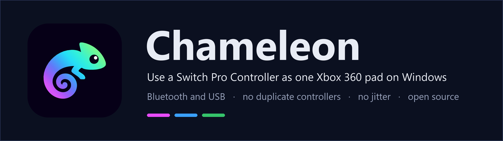
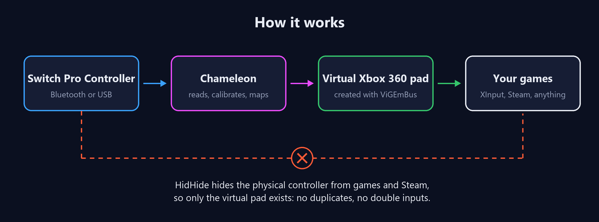
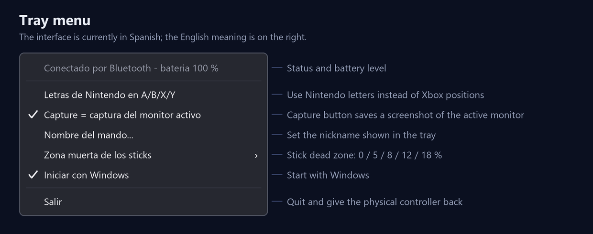
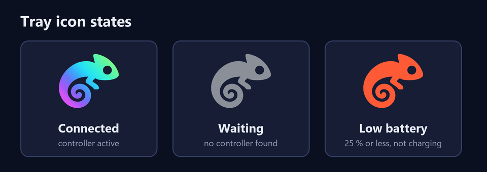

<p align="center">
  
</p>

<p align="center">
  <a href="https://github.com/VuloB1/chameleon-pro-controller/releases/latest"></a>
  
  <a href="LICENSE"></a>
</p>

**Chameleon** is a small Windows tray app that makes a **Nintendo Switch Pro Controller** look like a single, ordinary **Xbox 360 controller** to every game. It works over **Bluetooth and USB**, survives disconnects and reconnects without restarting anything, and hides the real controller so games never see duplicates.

It was built because the usual converters tend to show *two* controllers (the real one and the virtual one), jitter around the stick centre, or fight with Steam. Chameleon fixes those on purpose.

## Features

- **One controller, no duplicates.** The physical pad is hidden from games with [HidHide](https://github.com/nefarius/HidHide); only the virtual Xbox 360 pad exists.
- **Bluetooth and USB.** Plug it in or pair it; the app finds it by itself and keeps retrying if it goes away.
- **No reconnecting.** The virtual pad lives as long as the app does, so turning the controller off and on again just works.
- **No stick jitter.** The stick centre is measured every time the controller connects (many third-party pads ship with idealised calibration), and a radial dead zone removes the rest. The dead zone is configurable.
- **Rumble.** Games' rumble is forwarded to the controller (on/off).
- **Battery indicator** in the tray icon: it turns red when the battery is low and the pad is not charging.
- **Capture button = screenshot** of the monitor with the active window, saved to `Pictures\Screenshots` with a shutter sound. Optional.
- **Button layout of your choice:** Xbox positions (default) or Nintendo letters.
- **Nickname** for your controller, shown in the tray.
- **Start with Windows**, single instance, one-click installer that also installs the two drivers it needs.

## How it works

<p align="center">
  
</p>

1. Chameleon opens the Pro Controller over HID and switches it to its full input mode.
2. It reads the buttons and sticks, calibrates the stick centres and applies the dead zone.
3. It feeds one virtual Xbox 360 controller created through [ViGEmBus](https://github.com/nefarius/ViGEmBus).
4. [HidHide](https://github.com/nefarius/HidHide) hides the physical controller from every other program (only Chameleon is allowed to see it). It stays hidden while Chameleon is running, **including between disconnects**; this matters for Steam, which would otherwise grab the controller the moment it reconnects.

## Install

1. Download **`Chameleon-Setup-x.y.z.exe`** from the [latest release](https://github.com/VuloB1/chameleon-pro-controller/releases/latest).
2. Run it (administrator rights are required because it installs system drivers).
3. If **ViGEmBus** or **HidHide** are missing, the installer installs them for you. If you already have them (even an older ViGEmBus), they are left alone. Windows may ask for a restart after installing a driver.
4. Chameleon starts and appears in the system tray.

> **Windows SmartScreen:** the installer is not code-signed (a certificate costs money), so Windows may warn you. Choose **More info → Run anyway**. You can compare the file with the SHA-256 listed in the release notes, and the whole source is in this repository.

> **Language:** the app and installer interface are currently in **Spanish** only. English translation is on the wish list; the menu is explained below.

### Pairing the controller

- **Bluetooth:** hold the small sync button on top of the controller until the lights run back and forth, then add it in *Windows Settings → Bluetooth & devices → Add device → Bluetooth*.
- **USB:** just plug it in.

When Chameleon sees the controller it calibrates for a moment (**do not touch the sticks**), and then the tray icon turns on.

## Using it

<p align="center">
  
</p>

| Menu entry (Spanish) | What it does |
|---|---|
| *Conectado por … - batería …* | Status line: connection type and battery. |
| *Letras de Nintendo en A/B/X/Y* | Off (default): buttons keep their **positions** (Nintendo B at the bottom acts as Xbox A). On: the letters match (Nintendo B acts as Xbox B). |
| *Capture = captura del monitor activo* | The Capture button takes a screenshot of the active monitor. |
| *Nombre del mando…* | Sets the nickname shown in the tray tooltip (up to 20 characters). |
| *Zona muerta de los sticks* | 0 / 5 / 8 / 12 / 18 %. Default 8 %. |
| *Iniciar con Windows* | Starts Chameleon when you sign in. |
| *Salir* | Quits and gives the physical controller back to Windows. |

<p align="center">
  
</p>

### Button mapping

| Switch Pro Controller | Xbox 360 |
|---|---|
| B (bottom) / A (right) / Y (left) / X (top) | A / B / X / Y *(same positions; or same letters, see above)* |
| L / R | LB / RB |
| ZL / ZR | LT / RT *(fully pressed or released; the Pro Controller triggers are digital)* |
| − (Minus) / + (Plus) | Back / Start |
| Home | Guide |
| Left / right stick (and click) | Left / right stick (and click) |
| D-pad | D-pad |
| Capture | Takes a screenshot (not sent to the game) |

### Files

- Settings: `%AppData%\Chameleon\settings.json`
- Log of the current session: `%AppData%\Chameleon\log.txt`
- Screenshots: `%UserProfile%\Pictures\Screenshots\Chameleon yyyy-MM-dd HH-mm-ss.png`

## Steam

Steam Input wants to manage any controller it sees, which causes stray button presses and double controllers. Chameleon hides the physical pad from Steam, so Steam does not touch it, **provided the pad is hidden before Steam opens it**:

- The first time you run Chameleon with Steam already open and the controller already connected, Steam may already hold the pad. **Turn the controller off and on once**; from then on it is hidden at every reconnect.
- Steam can still treat the *virtual* Xbox 360 pad as an Xbox controller. If you see odd behaviour, turn off *Steam → Settings → Controller → Enable Steam Input for Xbox controllers*.

## Compatibility and limitations

- Tested with **one third-party (clone) Switch Pro Controller**, over Bluetooth and USB, on Windows 11. Genuine controllers should work (the protocol is the same and the centre is measured, not assumed), but they have not been tested by the author. Reports are welcome.
- **Rumble is on/off.** On the tested clone, amplitude is ignored by the hardware, so Chameleon sends a fixed pattern. HD rumble is not implemented.
- **Not supported:** gyroscope/motion, NFC/amiibo, Joy-Con (single or paired), analog triggers (the hardware has none), and more than one controller at a time.
- **Screenshots** use a regular screen grab: games in *exclusive* fullscreen may capture as black; windowed or borderless works.
- **Windows 10/11, x64 only.**
- ViGEmBus was retired by its author in 2023. It still works and is bundled/used as is; a replacement may be needed in the long run.

## Troubleshooting

| Symptom | Try |
|---|---|
| Games see two controllers | Check that HidHide is installed (the tray status says *(sin HidHide)* when it is missing). Turn the controller off and on once. |
| Nothing happens when connecting | Open `%AppData%\Chameleon\log.txt` to see what the app saw. Make sure only one Chameleon is running. |
| The controller stays invisible after Chameleon crashed | Start Chameleon again (it restores hidden devices at start), or uninstall it, which does the same. |
| Stray presses while Steam is open | See [Steam](#steam). |

## Uninstall

*Windows Settings → Apps → Chameleon → Uninstall*. This restores the physical controller, removes Chameleon from HidHide's list and from startup. **ViGEmBus and HidHide are left installed** because other programs may use them.

## Build from source

Requirements: Windows, [.NET 8 SDK](https://dotnet.microsoft.com/download/dotnet/8.0); for the installer, [Inno Setup 6](https://jrsoftware.org/isinfo.php).

```powershell
# the app (single self-contained .exe in dist\)
dotnet publish src/MandoSwitch -c Release -r win-x64 --self-contained `
  -p:PublishSingleFile=true -p:IncludeNativeLibrariesForSelfExtract=true `
  -p:EnableCompressionInSingleFile=true -o dist

# quick self-check of the parsing and calibration maths
dist\Chameleon.exe --selftest
```

To build the installer, download the two driver installers into `installer/deps/` with exactly these names and check their SHA-256:

| File | Source | SHA-256 |
|---|---|---|
| `ViGEmBus_1.22.0_x64_x86_arm64.exe` | [ViGEmBus releases](https://github.com/nefarius/ViGEmBus/releases) | `89220A7865076B342892F98865F3499FB7C4CFD673159E89D352C360FD014C6A` |
| `HidHide_1.5.230_x64.exe` | [HidHide releases](https://github.com/nefarius/HidHide/releases) | `F4BBBCB82E6258641B887C74BC81C4C5F66E4AA811808DFC304347687B7605F6` |

```powershell
& "$env:LOCALAPPDATA\Programs\Inno Setup 6\ISCC.exe" installer\MandoSwitch.iss
# -> installer\out\Chameleon-Setup-1.0.0.exe
```

> The source folder and several comments are in Spanish (the project started under the name *Mando Switch*). The assembly, installer and everything users see are named Chameleon.

## Technical notes

- **Protocol.** Over Bluetooth the controller starts in the simple report `0x3F`; sending subcommand `0x03` with argument `0x30` switches it to the full report `0x30`. Over USB the `0x80 0x02` handshake and `0x80 0x04` ("no timeout") come first. Report `0x30`: byte 2 battery/connection, bytes 3-5 buttons, bytes 6-11 the two sticks (12 bits per axis). Output goes in report `0x01` (subcommand in byte 10) or `0x10` (rumble only), with the length taken from the HID capabilities (49 over Bluetooth, 64 over USB).
- **Calibration.** The stick centre is the average of 40 frames taken when the controller connects; the radial range starts at 1500 counts and grows to what is observed (capped at 2047). Inside the dead zone the output is exactly zero.
- **Hiding.** HidHide's command-line tool is used to register Chameleon's executable, hide the device instance path and turn the cloak on. Everything is undone on exit, and any leftover from a crash is undone on the next start and by the uninstaller.
- **Layout.** `src/MandoSwitch/Pro.cs` (protocol, sticks), `Bridge.cs` (device loop, mapping, virtual pad), `Hide.cs` (HidHide), `Program.cs` (tray and self-test), `Settings.cs`, `Screenshot.cs`. `tools/` has two small PowerShell helpers (`probe.ps1` lists and reads Nintendo HID devices, `xinput-monitor.ps1` prints what XInput sees) that were used to reverse-engineer the clone.

## Credits and licenses

Chameleon is released under the [MIT license](LICENSE). It uses and, in the installer, redistributes:

- [ViGEmBus](https://github.com/nefarius/ViGEmBus) (BSD-3-Clause) and its [.NET client](https://github.com/nefarius/ViGEm.NET) (MIT), by Nefarius Software Solutions
- [HidHide](https://github.com/nefarius/HidHide) (MIT), by Nefarius Software Solutions
- [HidSharp](https://github.com/IntergatedCircuits/HidSharp) (Apache-2.0)
- .NET (MIT)

Full notices are in [`installer/THIRD-PARTY-NOTICES.txt`](installer/THIRD-PARTY-NOTICES.txt).

*Chameleon is an independent project. It is not affiliated with, endorsed by or sponsored by Nintendo or Microsoft. "Nintendo Switch", "Pro Controller" and "Xbox" are trademarks of their respective owners, used here only to describe compatibility.*
